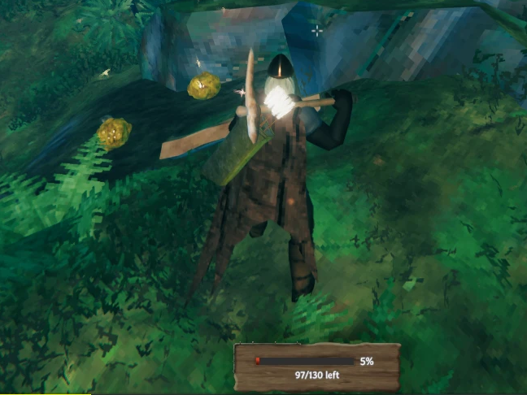

# Resource Scanner

A client-side BepInEx mod for Valheim: a small box at the bottom of the screen shows the health of the tree, log, stump, rock, ore deposit or nest you aim at. Right-click an ore deposit with a pickaxe to open an x-ray window with a live 3D view of the whole deposit, buried pieces included.

Mod para Valheim (BepInEx, client-side): uma caixinha no rodapé da tela mostra a vida da árvore, tronco, toco, pedra, depósito de minério ou ninho que você mira. Botão direito num depósito com a picareta abre uma janela de raio-x com uma vista 3D ao vivo do depósito inteiro, incluindo os pedaços enterrados.



For players, see [package/README.md](package/README.md). That file is also the Thunderstore page.
Para jogadores, veja [package/README.md](package/README.md).

Sister mods / mods irmãos: [Ore Weak Spots](https://github.com/Felihens/OreWeakSpots), [Tree Weak Spots](https://github.com/Felihens/TreeWeakSpots).

## Project layout

```
src/                C# source (Plugin.cs = config, Targets.cs = what you aim at and its health,
                    HealthHud.cs = the health box, XRay.cs = the x-ray window)
package/            Thunderstore package contents (manifest.json, icon.png, README.md, CHANGELOG.md)
docs/screenshots/   Images used by the Thunderstore page
build.sh            Compiles the DLL and copies it into the local game
pack.ps1            Builds dist/ResourceScanner-<version>.zip from package/
```

## Building

No Visual Studio or .NET SDK is needed. The build uses the C# compiler that ships with Windows (.NET Framework 4.x), so the code is limited to C# 5.

1. Install Valheim with BepInExPack.
2. Edit `GAME=` in `build.sh` to point at your Valheim folder.
3. Run `sh build.sh` from Git Bash (or `sh build.sh nocopy` to compile without installing).
4. Run `powershell -File pack.ps1` to build the release zip in `dist/`.

When you release a new version, update `VERSION` in `src/Plugin.cs`, `version_number` in `package/manifest.json`, and `package/CHANGELOG.md`.

## How it works

- No Harmony patches. A ray from the camera finds the `TreeBase`, `TreeLog`, `Destructible`, `MineRock` or `MineRock5` under the crosshair.
- Health is read from the object's ZDO, which every client receives, instead of listening to the damage RPC (that only runs on the object's owner). Max health uses the same world-level formula as the game.
  - `TreeBase`, `TreeLog`, `Destructible`: the `health` float.
  - `MineRock5`: the `health` string, a base64 `ZPackage` with one float per piece.
  - `MineRock`: one `Health<index>` float per piece.
- The box is built at runtime from the game's own UI: the inventory window's `Bkg` sprite, the tooltip font, and a copy of the enemy hud's health bar (`GuiBar`).
- The x-ray window draws the living pieces' meshes with their own materials into an orthographic camera on an unused layer (`Graphics.DrawMesh` with that camera only), rendered to a `RenderTexture` shown in a `RawImage`. Its light is switched on only while that camera renders, because deferred rendering ignores light culling masks.

## License

MIT. See [LICENSE](LICENSE).
