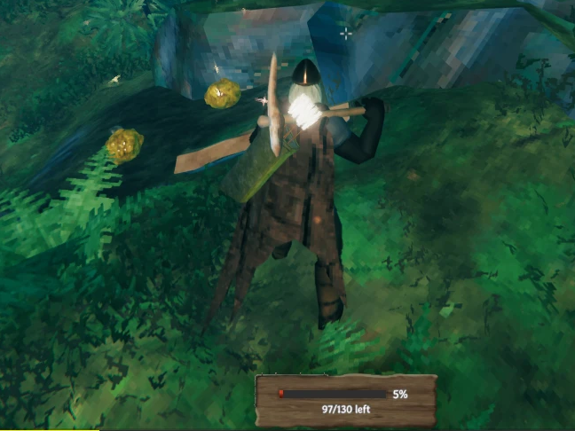
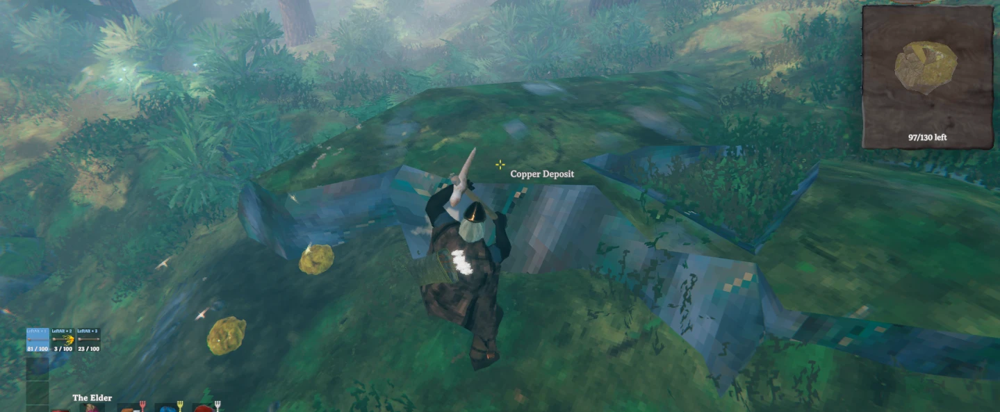

# Resource Scanner

**[English](#english) · [Português](#português)**

---

## English

See how much is left of whatever you're chopping or mining. Aim at a tree, log, stump, rock, ore deposit or nest and a small box at the bottom of the screen shows its health, in the same wooden style as the game's inventory. On an ore deposit, right-click with your pickaxe to open an x-ray window with a live 3D view of the whole deposit, including everything buried under the ground.

### Features

- **Client-side only.** The server and other players don't need the mod.
- **Health box** for trees, logs, stumps, rocks, ore deposits and nests (Greydwarf nests, bone piles, body piles).
- **Pieces left:** big deposits are made of many pieces, so the box also shows how many are left, e.g. `117/130 left`.
- **Works on servers.** Health is read from the data the server sends to everyone, so it shows even when another player controls the object. Older mods only updated on the player who owned it.
- **Shown only with the right tool:** an axe for trees, logs and stumps, a pickaxe for rocks and ores. Nests show with anything in hand. This can be turned off.
- **X-ray window:** aim at an ore deposit or big rock with a pickaxe and press the right mouse button.
  - A window under the minimap shows the deposit in 3D, without the ground, turning with your view.
  - A see-through plane marks ground level, so you can tell what's buried.
  - The piece you aim at is highlighted, and broken pieces disappear right away.
  - It closes when you put the pickaxe away or stop aiming at the deposit for 3 seconds.
- The box and the window are built from the game's own interface: the inventory frame, the game's font and the creature health bar.

### Requirements

- [BepInExPack Valheim](https://thunderstore.io/c/valheim/p/denikson/BepInExPack_Valheim/)

### Installation

**r2modman / Thunderstore Mod Manager:** click *Install*. To install a downloaded zip, go to Settings → *Import local mod*.

**Manual:**
1. Extract the zip.
2. Copy the `plugins/ResourceScanner` folder into `Valheim/BepInEx/plugins/`.
   Result: `Valheim/BepInEx/plugins/ResourceScanner/ResourceScanner.dll`.
3. Launch the game.

To update, delete the old `ResourceScanner` folder before copying the new one.

### Configuration

Press **F1** in game (requires Configuration Manager) or edit `BepInEx/config/felih.ResourceScanner.cfg`.

| Option | Default | What it does |
|---|---|---|
| Enabled | on | Turns the mod on or off. |
| RequireTool | on | Only show the box while holding the right tool. |
| Reach | 4 m | How far past your character an object can be. |
| HideDelay | 1 s | How long the box stays after you stop aiming. |
| Format | Percent | `Percent` (62%) or `Numbers` (1240 / 2000). |
| OffsetX / OffsetY | 0 | Moves the box. It sits at the bottom center by default. |
| Scale | 1 | Size of the box. |
| X-ray: Enabled | on | Turns the x-ray window on or off. |
| XRayKey | Mouse1 | Key or mouse button that opens the window (Mouse1 = right mouse button). |
| CloseAfter | 3 s | Seconds without aiming at the deposit before the window closes. |
| WindowSize | 220 | Size of the 3D view (after a restart). |
| GroundPlane | on | See-through plane at ground level. |
| WindowOffsetX / WindowOffsetY | 0 | Moves the window. It sits under the minimap by default. |

### Notes

- Inspired by **Ore Status** and **Tree Status** by JoelOliMclean, which no longer work well on current Valheim. This is a new mod written from scratch.
- Works well with **Ore Weak Spots** and **Tree Weak Spots** (same author).

---

## Português

Veja quanto falta de tudo o que você está cortando ou minerando. Mire numa árvore, tronco, toco, pedra, depósito de minério ou ninho e uma caixinha no rodapé da tela mostra a vida dele, no mesmo estilo de madeira do inventário do jogo. Num depósito de minério, clique com o botão direito segurando a picareta para abrir uma janela de raio-x com uma vista 3D ao vivo do depósito inteiro, incluindo tudo o que está enterrado.

### Recursos

- **Só no seu jogo.** O servidor e os outros jogadores não precisam ter o mod.
- **Caixa de vida** para árvores, troncos, tocos, pedras, depósitos de minério e ninhos (ninhos de Greydwarf, pilhas de ossos e de corpos).
- **Pedaços restantes:** depósitos grandes são feitos de vários pedaços, então a caixa também mostra quantos restam, por exemplo `117/130 left`.
- **Funciona em servidores.** A vida é lida dos dados que o servidor envia a todos, então aparece mesmo quando outro jogador controla o objeto. Os mods antigos só atualizavam para quem era o dono dele.
- **Só com a ferramenta certa:** machado para árvores, troncos e tocos; picareta para pedras e minérios. Ninhos aparecem com qualquer coisa na mão. Dá para desligar essa regra.
- **Janela de raio-x:** mire num depósito de minério ou pedra grande com a picareta e aperte o botão direito do mouse.
  - Uma janela abaixo do minimapa mostra o depósito em 3D, sem a terra, girando conforme a sua visão.
  - Um plano translúcido marca o nível do chão, para você ver o que está enterrado.
  - O pedaço que você mira fica destacado, e os pedaços quebrados somem na hora.
  - Ela fecha quando você guarda a picareta ou fica 3 segundos sem mirar no depósito.
- A caixa e a janela usam a própria interface do jogo: a moldura do inventário, a fonte do jogo e a barra de vida das criaturas.

### Requisitos

- [BepInExPack Valheim](https://thunderstore.io/c/valheim/p/denikson/BepInExPack_Valheim/)

### Instalação

**r2modman / Thunderstore Mod Manager:** clique em *Install*. Para instalar um zip baixado, use Configurações → *Import local mod*.

**À mão:**
1. Extraia o zip.
2. Copie a pasta `plugins/ResourceScanner` para dentro de `Valheim/BepInEx/plugins/`.
   Resultado: `Valheim/BepInEx/plugins/ResourceScanner/ResourceScanner.dll`.
3. Abra o jogo.

Para atualizar, apague a pasta `ResourceScanner` antiga antes de copiar a nova.

### Configuração

Aperte **F1** no jogo (precisa do Configuration Manager) ou edite `BepInEx/config/felih.ResourceScanner.cfg`.

| Opção | Padrão | O que faz |
|---|---|---|
| Enabled | ligado | Liga/desliga o mod. |
| RequireTool | ligado | Só mostra a caixa com a ferramenta certa na mão. |
| Reach | 4 m | Até que distância além do personagem o objeto pode estar. |
| HideDelay | 1 s | Quanto tempo a caixa fica depois que você para de mirar. |
| Format | Percent | `Percent` (62%) ou `Numbers` (1240 / 2000). |
| OffsetX / OffsetY | 0 | Move a caixa. Por padrão ela fica no centro do rodapé. |
| Scale | 1 | Tamanho da caixa. |
| X-ray: Enabled | ligado | Liga/desliga a janela de raio-x. |
| XRayKey | Mouse1 | Tecla ou botão que abre a janela (Mouse1 = botão direito). |
| CloseAfter | 3 s | Segundos sem mirar no depósito até a janela fechar. |
| WindowSize | 220 | Tamanho da vista 3D (vale depois de reiniciar). |
| GroundPlane | ligado | Plano translúcido no nível do chão. |
| WindowOffsetX / WindowOffsetY | 0 | Move a janela. Por padrão ela fica abaixo do minimapa. |

### Observações

- Inspirado no **Ore Status** e no **Tree Status**, de JoelOliMclean, que não funcionam mais direito no Valheim atual. Este é um mod novo, escrito do zero.
- Combina com o **Ore Weak Spots** e o **Tree Weak Spots** (mesmo autor).
